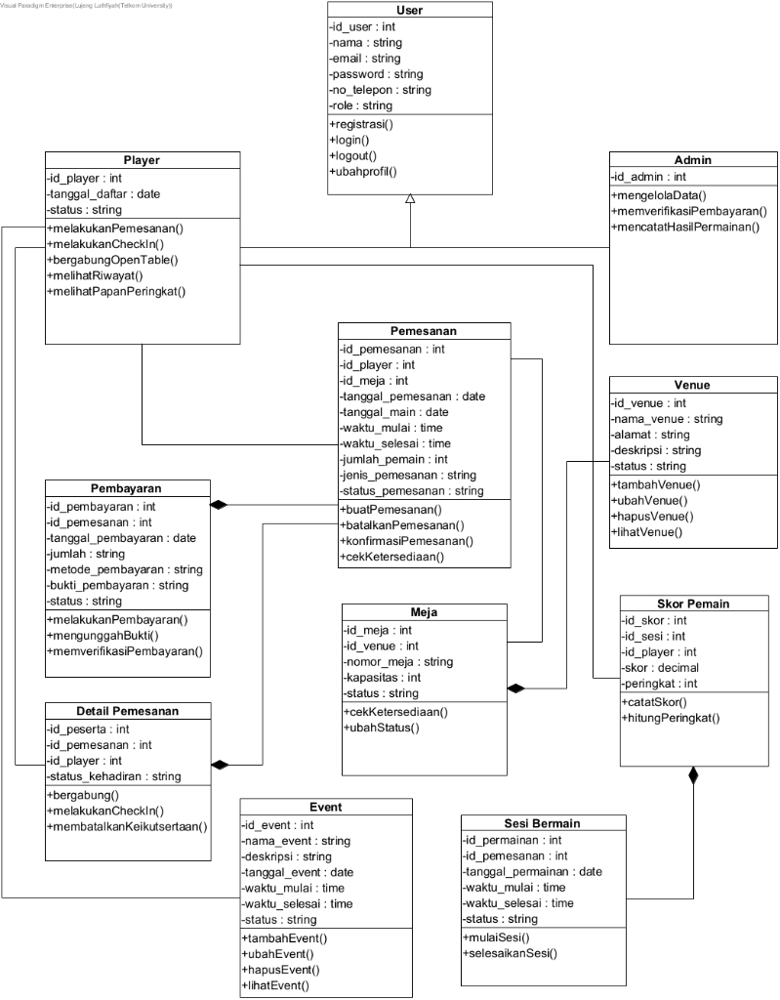

<p align="center">
  
</p>

<h1 align="center">MahjongYuks — Integrated Web Platform</h1>

<p align="center">
  <strong>Sistem Informasi Terintegrasi Multi-Venue, Reservasi Meja Otomatis & Komunitas Mind Sports Mahjong Indonesia</strong><br>
  <em>Capstone Design Project — Program Studi S1 Sistem Informasi, Fakultas Rekayasa Industri, Universitas Telkom Jakarta</em>
</p>

<p align="center">
  
  
  
  
  
  
  
  
</p>

---

## 📑 Daftar Isi
1. [Tentang Proyek](#-tentang-proyek)
2. [Fitur Utama Sistem](#-fitur-utama-sistem)
3. [Arsitektur Sistem & Alur Data](#-arsitektur-sistem--alur-data)
4. [Desain Database & ERD Resmi](#-desain-database--erd-resmi)
5. [Tech Stack & Spesifikasi](#-tech-stack--spesifikasi)
6. [Prasyarat Sistem (Prerequisites)](#-prasyarat-sistem-prerequisites)
7. [Panduan Instalasi Langkah Demi Langkah (Getting Started)](#-panduan-instalasi-langkah-demi-langkah)
   - [Langkah 1: Database MySQL](#1-persiapan-database-mysql)
   - [Langkah 2: Setup Backend (Laravel API)](#2-setup-backend-laravel-api)
   - [Langkah 3: Setup Frontend (Next.js)](#3-setup-frontend-nextjs)
8. [Referensi Konfigurasi Environment (`.env`)](#-referensi-konfigurasi-environment)
9. [Akun Pengujian (Seeder Credentials)](#-akun-pengujian-seeder-credentials)
10. [Dokumentasi Rute Web & REST API](#-dokumentasi-rute-web--rest-api)
11. [Struktur Direktori Codebase](#-struktur-direktori-codebase)
12. [Troubleshooting & Solusi Error](#-troubleshooting--solusi-error)
13. [Tim Pengembang & Pembagian Modul](#-tim-pengembang--pembagian-modul)
14. [Standar & Kepatuhan Regulasi](#-standar--kepatuhan-regulasi)

---

## 📖 Tentang Proyek

**MahjongYuks** adalah sistem informasi full-stack terintegrasi berbasis web yang dirancang khusus untuk mengelola ekosistem game house multi-venue dan arena kompetisi resmi *Hong Kong / Riichi Mahjong* di Indonesia.

Di era modern, permainan Mahjong telah berevolusi menjadi cabang olahraga asah otak (*Mind Sports*) berstandar internasional (**World Riichi Championship / WRC** dan **European Mahjong Association / EMA**) yang dimainkan di salon ber-AC menggunakan **meja pengocok magnetik otomatis (Amos Rexx III)** tanpa unsur perjudian.

Sistem ini hadir untuk menggantikan pencatatan manual di parlor, mengotomatisasi pemesanan kursi 4 kuadran, mencatat kehadiran dengan timestamp digital, memverifikasi simulasi pembayaran kasir, serta menghitung peringkat kompetisi (*Dan/Kyu Rating & Leaderboard*) secara transparan dan akuntabel.

---

## ⚡ Fitur Utama Sistem

Sistem mencakup 8 Requirement Fungsional (RF) utama sesuai spesifikasi dokumen Capstone:

| Kode RF | Modul | Deskripsi Fungsional |
|---|---|---|
| **RF-01** | **Manajemen Pengguna & Autentikasi** | Registrasi & Login terenkripsi bcrypt, token otentikasi aman (Laravel Sanctum), pemisahan peran (*Role-Based Access Control* antara Pemain & Staf Admin). |
| **RF-02** | **Informasi Venue & Event** | Landing page interaktif menampilkan katalog venue berlisensi, jadwal turnamen aktif, filter sesi harian, dan live status ketersediaan meja. |
| **RF-03** | **Reservasi Meja & Kursi (Seat Booking)** | Pemilihan jadwal & meja dengan visual denah 4 kuadran angin (*Timur/Ton, Selatan/Nan, Barat/Sha, Utara/Pei*). Validasi ketat kapasitas meja **maksimal 4 pemain**. |
| **RF-04** | **Simulasi Pembayaran** | Pencatatan transaksi reservasi, unggah bukti transfer simulasi, dan panel verifikasi admin (*Pending, Paid, Failed*). |
| **RF-05** | **Check-in Kehadiran Digital** | Check-in kehadiran pemain di venue berbasis timestamp presisi (WIB) dengan pass QR digital untuk konfirmasi operasional meja. |
| **RF-06** | **Pengelolaan Sesi Permainan** | Admin & wasit dapat membuka sesi meja yang telah terisi 4 pemain, memantau ronde berlangsung (*ongoing*), dan menutup sesi (*closed*). |
| **RF-07** | **Pencatatan Hasil & Skor Wasit** | Input skor akhir hanchiku/uma oleh meja wasit untuk mode *Competitive*, riwayat ronde, dan kalkulasi selisih poin pemain. |
| **RF-08** | **Leaderboard Nasional & Game History** | Akumulasi rating poin Elo pemain terdaftar, gelar Dan/Kyu (*Grandmaster, Master, Expert*), dan riwayat bermain pribadi (*Game History*). |

---

## 🏛 Arsitektur Sistem & Alur Data

Sistem menerapkan arsitektur **Monolithic Codebase Terpisah** (*Decoupled Frontend & Backend*) dengan komunikasi standar **RESTful API**:

```
 ┌──────────────────────────────────────────────────────────────┐
 │                      Klien (Web Browser)                     │
 │              Smartphone, Tablet, Desktop Laptop              │
 └──────────────────────────────┬───────────────────────────────┘
                                │ HTTP / HTTPS
                                ▼
 ┌──────────────────────────────────────────────────────────────┐
 │             FRONTEND: Next.js 16 (TypeScript)                │
 │   • App Router (/app)       • React Hooks & Context State    │
 │   • Centralized ApiClient   • Vanilla CSS Design System      │
 └──────────────────────────────┬───────────────────────────────┘
                                │ JSON REST API (Bearer Token)
                                ▼
 ┌──────────────────────────────────────────────────────────────┐
 │             BACKEND: Laravel 11 MVC (PHP 8.2+)               │
 │   • routes/api.php          • Controllers & FormRequests     │
 │   • Sanctum Token Guard     • Eloquent ORM Models            │
 └──────────────────────────────┬───────────────────────────────┘
                                │ MySQL Driver (Port 3306)
                                ▼
 ┌──────────────────────────────────────────────────────────────┐
 │                 DATABASE: MySQL 8.x / MariaDB                │
 │           10 Tabel Relasional Sesuai ERD Resmi Capstone      │
 └──────────────────────────────────────────────────────────────┘
```

---

## 🗄 Desain Database & ERD Resmi

Skema database didasarkan pada **Class Diagram resmi (Visual Paradigm)** dari kurikulum Capstone S1 Sistem Informasi Universitas Telkom:

<p align="center">
  
</p>

### Kamus Entitas & Relasi Data

```
User (Parent)
 ├── Player (Subtype, 1-to-1 dengan User)
 └── Admin  (Subtype, 1-to-1 dengan User)

Venue ─── (1:N) ─── Meja (Kapasitas: 4 pemain)
Event (Standalone / Terkait Venue & Sesi)

Player ─────── (1:N) ─── Pemesanan ─── (N:1) ─── Meja
Pemesanan ──── (1:1) ─── Pembayaran
Pemesanan ──── (1:N) ─── Detail_Pemesanan (Daftar peserta & status kehadiran)
Pemesanan ──── (1:1) ─── Sesi_Bermain
Sesi_Bermain ─ (1:N) ─── Skor_Pemain (Peringkat & Skor akhir per pemain)
```

> **Aturan Bisnis Kritis**:
> 1. **Kapasitas Meja**: Satu meja dibatasi **maksimal 4 pemain**. Validasi wajib ditegakkan di backend dan frontend.
> 2. **Tidak Ada Tabel Schedule Terpisah**: Informasi waktu bermain melekat langsung pada entitas `pemesanans` (`tanggal_main`, `waktu_mulai`, `waktu_selesai`).
> 3. **Subtype User**: Pembeda akses utama menggunakan kolom `role` (`player` / `admin`) pada tabel `users`.
> 4. **Leaderboard**: Peringkat pemain diagregasikan dari akumulasi nilai `skor_pemains` yang terhubung ke `player_id`.

---

## 🛠 Tech Stack & Spesifikasi

### Frontend (`frontend/`)
- **Framework**: [Next.js 16](https://nextjs.org/) (App Router Architecture)
- **Library UI**: React 19, TypeScript (Strict Mode)
- **Styling**: Vanilla CSS Design Tokens (`globals.css`) dengan tipografi modern *Plus Jakarta Sans*
- **State Management**: React Context (`AuthContext.tsx`) + LocalStorage Session Sync
- **HTTP Client**: Centralized Fetch API Client (`src/lib/api.ts`)

### Backend (`mahjongyuks/`)
- **Framework**: [Laravel 11](https://laravel.com/)
- **Pola Desain**: MVC (Model-View-Controller)
- **Standar Bahasa**: PHP 8.2+ (Mengikuti standar PSR-12)
- **Otentikasi**: Token-based menggunakan **Laravel Sanctum**
- **Enkripsi Sandi**: bcrypt hashing standar industri
- **Database Engine**: MySQL 8.x (Storage Engine: InnoDB, Collation: `utf8mb4_unicode_ci`)

---

## 💻 Prasyarat Sistem (Prerequisites)

Sebelum menjalankan aplikasi, pastikan perangkat Anda telah terpasang:

| Perangkat Lunak | Versi Minimal | Fungsi Utama |
|---|---|---|
| **PHP** | `>= 8.2` | Runtime engine backend Laravel (Ekstensi: `pdo_mysql`, `mbstring`, `openssl`, `bcmath`, `curl`) |
| **Composer** | `>= 2.x` | Dependency manager pustaka PHP |
| **Node.js** | `>= 18.x` (LTS direkomendasikan) | Runtime engine frontend Next.js |
| **npm** | `>= 9.x` | Package manager JavaScript/TypeScript |
| **MySQL Server** | `>= 8.0` / MariaDB | Database relasional (bisa via XAMPP, Laragon, Docker, atau Standalone) |
| **Git** | `>= 2.x` | Version control system |

---

## 🚀 Panduan Instalasi Langkah Demi Langkah

### 1. Persiapan Database MySQL
1. Buka control panel **XAMPP** atau **Laragon**, lalu nyalakan service **MySQL** (port default `3306`).
2. Buat database baru bernama `mahjongyuks`:
   - **Via Terminal**:
     ```bash
     mysql -u root -e "CREATE DATABASE IF NOT EXISTS mahjongyuks CHARACTER SET utf8mb4 COLLATE utf8mb4_unicode_ci;"
     ```
   - **Via phpMyAdmin**: Buka `http://localhost/phpmyadmin`, buat database `mahjongyuks`.

---

### 2. Setup Backend (Laravel API)

Buka terminal di root repository `Capstone-05/`:

```bash
# 1. Pindah ke direktori backend
cd mahjongyuks

# 2. Pasang dependensi PHP via Composer
composer install

# 3. Salin file environment konfigurasi
cp .env.example .env

# 4. Generate application key
php artisan key:generate
```

#### Pengaturan Database di `.env`:
Buka file `mahjongyuks/.env`, pastikan konfigurasi berikut sesuai:
```ini
DB_CONNECTION=mysql
DB_HOST=127.0.0.1
DB_PORT=3306
DB_DATABASE=mahjongyuks
DB_USERNAME=root
DB_PASSWORD=
```
*(Sesuaikan `DB_PASSWORD` jika MySQL Anda memiliki kata sandi)*.

#### Eksekusi Migrasi & Data Seeder:
Jalankan perintah ini untuk membangun 10 tabel ERD dan mengisi data dummy venue, meja magnetik, event, dan atlet:
```bash
php artisan migrate:fresh --seed
```

#### Jalankan Server API Backend:
```bash
php artisan serve
```
> Server REST API aktif di: **`http://localhost:8000`** *(Biarkan terminal ini tetap menyala)*.

---

### 3. Setup Frontend (Next.js)

Buka **jendela terminal baru** (tanpa menutup terminal backend):

```bash
# 1. Pindah ke direktori frontend
cd frontend

# 2. Pasang dependensi Node.js
npm install

# 3. Buat file environment konfigurasi frontend
cp .env.example .env.local 2>/dev/null || echo "NEXT_PUBLIC_API_URL=http://localhost:8000/api" > .env.local
```

Pastikan file `frontend/.env.local` berisi:
```ini
NEXT_PUBLIC_API_URL=http://localhost:8000/api
```

#### Jalankan Server Pengembangan:
```bash
npm run dev
```
> Website MahjongYuks dapat diakses di: **`http://localhost:3000`**.

---

## ⚙️ Referensi Konfigurasi Environment

### Backend (`mahjongyuks/.env`)
| Variabel | Tipe Data | Nilai Default | Keterangan |
|---|---|---|---|
| `APP_NAME` | String | `MahjongYuks` | Nama aplikasi di Laravel |
| `APP_ENV` | String | `local` | Lingkungan runtime (`local`/`production`) |
| `APP_URL` | URL | `http://localhost:8000` | Base URL server backend |
| `DB_CONNECTION` | String | `mysql` | Driver database |
| `DB_PORT` | Integer | `3306` | Port listening MySQL server |
| `DB_DATABASE` | String | `mahjongyuks` | Nama skema database |
| `DB_USERNAME` | String | `root` | Username akun MySQL |
| `DB_PASSWORD` | String | `""` (kosong) | Password akun MySQL |

### Frontend (`frontend/.env.local`)
| Variabel | Tipe Data | Nilai Default | Keterangan |
|---|---|---|---|
| `NEXT_PUBLIC_API_URL` | URL | `http://localhost:8000/api` | Target endpoint REST API backend |

---

## 🔑 Akun Pengujian (Seeder Credentials)

Database seeder telah menyediakan kredensial siap pakai untuk pengujian fitur:

### 1. Akun Pemain (Player Portal)
- **Halaman Masuk**: `http://localhost:3000/login`
- **Email**: `kevin.sanjaya@mahjongyuks.id`
- **Kata Sandi**: `password123`
- **Role**: `player` (Gelar: *5-Dan Master*, Poin: 14.850 pts)
- **Fitur Tersedia**: Reservasi meja 4 kuadran, e-ticket QR check-in, katalog event dimsum, personal game history.

### 2. Akun Staf Operasional / Admin (Backoffice Panel)
- **Halaman Masuk**: `http://localhost:3000/admin/login`
- **Email Admin**: `admin@mahjongyuks.id` *(atau `admin.sedayu@mahjongyuks.id`)*
- **Kata Sandi**: `password123`
- **Role**: `admin`
- **Fitur Tersedia**: Panel verifikasi pembayaran kasir, input skor akhir turnamen (Uma desk), monitor live okupansi meja magnetik.

---

## 🌐 Dokumentasi Rute Web & REST API

### 1. Halaman Web Antarmuka (`http://localhost:3000`)
| Path URL | Halaman | Hak Akses | Keterangan |
|---|---|---|---|
| `/` | **Landing Page Publik** | Publik (Tamu) | Showcase brand, katalog event unggulan, filter sesi, leaderboard top 3, dan panduan bermain 101. |
| `/login` | **Portal Masuk Pemain** | Publik / Tamu | Form login fleksibel (Email & opsi nomor HP), deteksi peran cerdas. |
| `/register` | **Registrasi Anggota** | Publik / Tamu | Pendaftaran pemain baru, pilihan tingkat kemahiran (*Pemula / Menengah / Mahir*), persetujuan fairplay. |
| `/dashboard` | **Dashboard Pemain** | Pemain (`player`) | Denah meja live, QR pass kehadiran, riwayat bermain, profil atlet. |
| `/admin/login` | **Portal Staf & Wasit** | Staf Venue | Pintu masuk terpisah untuk petugas operasional & wasit turnamen. |
| `/admin/dashboard` | **Admin Management Center** | Admin (`admin`) | Verifikasi bukti bayar transfer, meja wasit skor akhir, monitor okupansi arena. |

### 2. Rute REST API Laravel (`http://localhost:8000/api`)

#### Autentikasi Pengguna (`/api/auth`)
| Method | Endpoint | Proteksi | Deskripsi |
|---|---|---|---|
| `POST` | `/api/auth/register` | Publik | Mendaftarkan pemain baru & mengembalikan token sesi |
| `POST` | `/api/auth/login` | Publik | Autentikasi kredensial (Email/No. HP + Sandi), mengembalikan Bearer Token |
| `POST` | `/api/auth/logout` | `auth:sanctum` | Revoke token aktif dan menutup sesi aman |
| `GET` | `/api/auth/me` | `auth:sanctum` | Mengambil data profil pengguna yang sedang login |

#### Format Respons Standar JSON
```json
// Respons Sukses (HTTP 200/201)
{
  "success": true,
  "message": "Operasi berhasil diselesaikan",
  "data": { ... }
}

// Respons Error (HTTP 400/401/422/500)
{
  "success": false,
  "message": "Validasi gagal / Kredensial tidak valid",
  "errors": { ... }
}
```

---

## 📁 Struktur Direktori Codebase

```
Capstone-05/
├── README.md               # Dokumentasi resmi proyek (Tech Docs & Setup Guide)
├── AGENTS.md               # Spesifikasi arsitektur & panduan agen pengembang
├── docs/
│   └── assets/
│       ├── erd.png         # Gambar Class Diagram ERD resmi
│       └── logo.png        # Logo resmi MahjongYuks
├── frontend/               # [NEXT.JS 16 FRONTEND]
│   ├── public/             # Aset statis gambar, ubin mahjong, & foto parlor
│   │   ├── assets/         # Logo resmi mahjongyuks_logo.png & avatar
│   │   └── landing/        # Aset gambar showcase landing page
│   ├── src/
│   │   ├── app/            # Halaman Next.js App Router
│   │   │   ├── page.tsx    # Landing page publik utama
│   │   │   ├── login/      # Halaman login pemain
│   │   │   ├── register/   # Halaman registrasi anggota
│   │   │   ├── dashboard/  # Dashboard pemain
│   │   │   └── admin/      # Rute portal staf operasional & wasit
│   │   ├── context/        # React AuthContext (Session state management)
│   │   └── lib/            # Centralized API Client (ApiClient)
│   ├── package.json
│   └── tsconfig.json
└── mahjongyuks/            # [LARAVEL 11 REST API BACKEND]
    ├── app/
    │   ├── Http/Controllers/Api/ # Controller autentikasi & entitas API
    │   └── Models/               # Model Eloquent (User, Player, Venue, Meja, dll)
    ├── database/
    │   ├── migrations/           # 10 skema migrasi tabel ERD resmi
    │   └── seeders/              # DatabaseSeeder akun pengujian & arena meja
    ├── routes/
    │   └── api.php               # Definisi route REST API
    ├── composer.json
    └── artisan
```

---

## 🛠 Troubleshooting & Solusi Error

### 1. `SQLSTATE[HY000] [2002] Connection refused`
- **Penyebab**: Service database MySQL belum aktif di sistem lokal Anda.
- **Solusi**: Nyalakan service MySQL pada panel XAMPP atau Laragon hingga berwarna hijau. Jika menggunakan port kustom (selain `3306`), sesuaikan `DB_PORT` di file `mahjongyuks/.env`.

### 2. `Table 'mahjongyuks.users' doesn't exist`
- **Penyebab**: Tabel database belum dimigrasikan dari file skema Laravel.
- **Solusi**: Jalankan perintah migrasi dan pengisian data:
  ```bash
  cd mahjongyuks
  php artisan migrate:fresh --seed
  ```

### 3. Port `3000` atau `8000` Sudah Terpakai (*Address already in use*)
- **Solusi (Linux/macOS)**:
  ```bash
  fuser -k 3000/tcp
  fuser -k 8000/tcp
  ```
- **Solusi (Windows)**: Buka *Task Manager*, hentikan proses `Node.js JavaScript Runtime` atau `php.exe` yang berjalan di latar belakang.

### 4. Peringatan Gateway OTP dalam Pengembangan
- Pengiriman kode OTP via SMS/Nodemailer saat ini masih dalam status simulasi *Under Development*. Harap gunakan opsi **Masuk Menggunakan Email** dan kata sandi yang telah terdaftar.

---

## 👥 Tim Pengembang & Pembagian Modul

Proyek Capstone Design — S1 Sistem Informasi, Fakultas Rekayasa Industri, Universitas Telkom Jakarta:

| NIM | Nama Mahasiswa | Tanggung Jawab Modul / PIC | Sprint Agile |
|---|---|---|---|
| **102042300070** | **Denis Hendri Wawo** | Autentikasi Pengguna & Pemesanan Kursi | Sprint 1 & Sprint 3 |
| **102042300039** | **Lujeng LuthFiyah** | Manajemen Informasi Event & Venue Salon | Sprint 2 |
| **102042300005** | **Zabila Nanda Irawan** | Simulasi Pembayaran & Verifikasi Admin | Sprint 4 |
| **102042300204** | **Sarah Dinda Siregar** | Leaderboard Nasional & Game History Pemain | Sprint 6 |

---

## ⚖️ Standar & Kepatuhan Regulasi

Sistem informasi MahjongYuks dikembangkan dengan mengacu pada standar hukum dan teknis yang berlaku:
- **UU No. 27 Tahun 2022 tentang Pelindungan Data Pribadi (UU PDP)**: Data kredensial pengguna, nomor telepon, dan bukti transfer dilindungi dan hanya dapat diakses staf berwenang.
- **PP No. 71 Tahun 2019 tentang Penyelenggaraan Sistem dan Transaksi Elektronik (PSTE)**: Setiap transaksi reservasi dan pencatatan skor wasit terekam secara otomatis dengan timestamp presisi.
- **ISO/IEC 27001 (CIA Triad)**: Penegakan *Confidentiality* (bcrypt hashing), *Integrity* (validasi input ganda di frontend & backend), dan *Availability* (arsitektur performa tinggi Next.js & MySQL).
- **Regulasi Mind Sports WRC & EMA**: Penegakan aturan permainan adil (*zero table-talk* dan non-gambling sports).

---

<p align="center">
  <sub>© 2025 MahjongYuks Indonesia • Telkom University Jakarta Capstone Project • All Rights Reserved.</sub>
</p>
